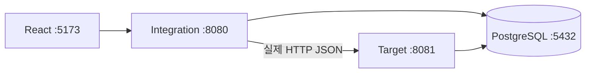

# InterfaceFlow Lab

Java Spring Boot와 React로 구현하는 시스템 연동 검증·장애 시뮬레이션 포트폴리오입니다. 공개 가능한 가상 데이터만 사용합니다.

현재 범위는 **Phase 0·1**입니다. 두 독립 Spring Boot 서버의 실제 HTTP 통신, PostgreSQL 수신·처리 메타데이터, Trace 헤더 전파, 한국어 React 전송 콘솔을 구현합니다. 최종 목표와 현재 구현을 구분하며, 장애 시뮬레이션·매핑·재시도·멱등성은 후속 단계입니다.



기술: Java 21, Spring Boot 3.5.7, MyBatis 3.0.5 XML Mapper, Flyway, PostgreSQL 17, RestClient/JDK HttpClient, Actuator, springdoc OpenAPI, React 19.2, TypeScript 5.9, Vite 7.1, Vitest. 선택 근거는 [ADR](docs/DECISIONS.md)에 기록합니다.

## Docker 로컬 실행

Docker Engine/Desktop과 Compose v2가 필요합니다. 저장소 루트에서:

```powershell
Copy-Item .env.example .env
# .env의 DB_PASSWORD를 로컬 개발용 값으로 변경
docker compose up --build -d
docker compose logs -f integration target
```

콘솔: http://localhost:5173 · Integration health: http://localhost:8080/actuator/health · Target health: http://localhost:8081/actuator/health. 서비스 시작 직후 DB migration이 끝날 때까지 잠시 기다리세요. `docker compose down`으로 종료하며 DB volume은 유지됩니다.

## 개별 개발 실행

Java 21, Maven 3.9+, Node 22.12+, PostgreSQL이 필요합니다. Docker DB만 띄우려면 `.env` 설정 후 `docker compose up -d db`를 실행합니다.

```powershell
$env:DB_PASSWORD='로컬 설정 값'
mvn -B -s .mvn/settings.xml clean verify
java -jar backend/target-simulator/target/target-simulator-0.1.0-SNAPSHOT.jar
# 별도 터미널 (같은 DB_PASSWORD 환경 변수 지정)
java -jar backend/integration-server/target/integration-server-0.1.0-SNAPSHOT.jar
# 별도 터미널
cd frontend
npm ci
npm run dev
```

DB_URL 기본값은 `jdbc:postgresql://localhost:5432/interfaceflow`, DB_USER는 `interfaceflow`. Integration의 TARGET_URL 기본값은 `http://localhost:8081`, TARGET_TIMEOUT_MS는 3000입니다. Vite 개발 서버가 /api를 Integration에 프록시하므로 별도 CORS 허용이 필요하지 않습니다.

## 화면과 테스트 요청

전문 전송 화면에서 고정 IF-USER-001을 선택하고 샘플 JSON을 불러온 후 전송합니다. 오른쪽에 status, traceId, attemptId, HTTP 결과가 표시됩니다. 다크/라이트 전환과 좁은 화면 레이아웃을 제공합니다. 대시보드 지표와 이력 화면은 아직 제공하지 않습니다.

```powershell
$body = @{ interfaceId='IF-USER-001'; requestId='REQ-DEMO-0001'; payload=@{userId='USER001';userName='홍길동'} } | ConvertTo-Json
Invoke-RestMethod http://localhost:8080/api/requests -Method Post -ContentType 'application/json; charset=utf-8' -Body ([Text.Encoding]::UTF8.GetBytes($body))
```

같은 traceId가 응답과 대상 HTTP 응답에 포함됩니다. `docker compose logs integration target`에서 traceId를 검색하거나 다음 SQL로 양쪽 기록을 조회합니다.

```sql
SELECT * FROM integration.if_request WHERE trace_id = '응답의 traceId';
SELECT * FROM target.if_target_receipt WHERE trace_id = '응답의 traceId';
```

OpenAPI는 각 서버 `/swagger-ui/index.html`과 `/v3/api-docs`에서 확인합니다. [API 계약](docs/API.md), [테스트 시나리오](docs/TEST-SCENARIOS.md), [상세 아키텍처](docs/ARCHITECTURE.md)를 참고하세요.

## 자동 검증

```powershell
mvn -B -s .mvn/settings.xml verify
cd frontend
npm test
npm run build
```

기본 Maven 검증은 단위·HTTP 테스트를 실행합니다. DB 통합 테스트는 명시적으로 활성화합니다.

```powershell
$env:RUN_DB_TESTS='true'
mvn -B -s .mvn/settings.xml verify
```

위 명령은 Docker의 PostgreSQL 17 Testcontainers를 사용합니다. 별도의 폐기 가능한 로컬 PostgreSQL을 쓰려면 `TEST_DB_URL=jdbc:postgresql://localhost:5432/테스트DB`를 지정하세요. 이 경로는 사용자 `interfaceflow`, 암호 `local-test`인 테스트 전용 DB를 기대합니다. 두 경로 모두 실제 Flyway migration과 MyBatis를 실행합니다. Testcontainers는 이 PC에 Docker가 없어 실행하지 않았으며, 임시 PostgreSQL 17.6에서 외부 DB 경로를 검증했습니다.

별도 JVM 왕복 smoke 검증은 빌드 후 DB_URL, DB_USER, DB_PASSWORD 환경 변수를 지정하고 `./scripts/Test-Smoke.ps1`을 실행합니다. Java 21이 PATH에 없다면 `-Java 'JDK21의 java.exe 경로'`를 지정합니다. 기본 18080/18081 포트에서 두 JAR를 실행·검증한 후 종료합니다.

실제 브라우저와 양쪽 DB 기록까지 검사하려면 설치된 Chrome과 frontend 의존성이 준비된 상태에서 실행합니다.

```powershell
./scripts/Test-Smoke.ps1 -BrowserTests
```

스크립트는 두 JVM과 개발 프록시를 연결하여 데스크톱·모바일 너비의 Playwright 테스트 12건을 실행합니다. 정상 전송은 실제 HTTP와 PostgreSQL을 사용하며, 네트워크 중단·HTML 502 피드백만 별도 오류 주입으로 검사합니다. 각 전송은 테스트 이력을 남기므로 폐기 가능한 DB를 사용하세요. Edge는 `PLAYWRIGHT_CHANNEL=msedge`, Playwright Chromium은 `npx playwright install chromium` 후 `PLAYWRIGHT_CHANNEL=chromium`을 지정할 수 있습니다.

이미 실행 중인 Compose 스택을 검사하려면 frontend 폴더에서 `E2E_BASE_URL=http://127.0.0.1:5173`, `E2E_DB_URL=postgresql://127.0.0.1:5432/interfaceflow`, 해당 DB_USER/DB_PASSWORD 환경 변수를 설정한 뒤 `npm run test:e2e`를 실행합니다. E2E_BASE_URL을 지정하지 않으면 Vite가 15173 포트에서 시작되며 `API_PROXY_TARGET`(기본 localhost:8080)을 사용합니다. 테스트용 DB 연결 변수는 브라우저 번들로 전달하지 않습니다.

보고서는 `frontend/playwright-report`, 캡처는 `frontend/test-results`에 생성됩니다. 로컬 Chrome에서 실제 전송·DB 일치와 화면을 검증했습니다. [데스크톱 화면](docs/screenshots/phase1-desktop.png), [모바일 너비 화면](docs/screenshots/phase1-mobile.png), [라이트 모드](docs/screenshots/phase1-mobile-light.png)를 확인할 수 있습니다.

GitHub Actions에 Java 21/Node 22와 Testcontainers 검증, Compose 전체 스택의 브라우저·DB 검증 작업을 구성했습니다. Docker가 없는 이 PC에서는 Compose/Testcontainers 경로와 원격 워크플로를 실행하지 않았습니다. 현재 실행 결과와 미검증 항목은 [PROGRESS](docs/PROGRESS.md)에 기록합니다.

## 알려진 제약과 다음 단계

- 현재 고정 인터페이스만 지원하며 사용자 필드 스키마 검증·매핑은 Phase 2입니다.
- 같은 Request ID를 다시 보내면 현재 별도 전송됩니다. 멱등성·자동/수동 재시도·프로세스 종료 복구는 Phase 5입니다.
- Timeout/5xx/응답 계약 오류는 UNKNOWN으로 기록합니다. 장애 시나리오 선택 UI와 재현 API는 Phase 4입니다. 연결 실패는 target을 중단하여 실제로 확인할 수 있습니다.
- DB에는 전문 원문을 저장하지 않습니다. Trace Explorer와 통합 조회는 Phase 3이며 현재 로그·SQL로 조회합니다.
- 인증은 미구현입니다. Compose는 localhost에만 노출합니다. 프론트엔드만 GitHub Pages에 배포해도 백엔드는 실행되지 않습니다.
- 실제 HTTP 통신과 기록의 기반 단계이며 exactly-once 전달을 보장하지 않습니다.

최종적으로 timeout 이후 처리 불확실성, 중복 요청, 재시도와 복구 과정을 재현하고 근거를 추적하는 플랫폼을 목표로 합니다. [PROJECT](PROJECT.md)는 전체 명세이며 구현 완료 목록이 아닙니다.
