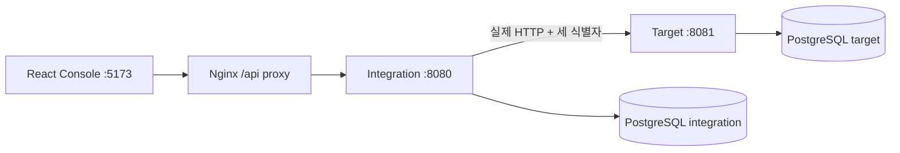

# InterfaceFlow Lab

두 독립 Spring Boot 서버의 실제 HTTP 통신으로 전문 검증·매핑·장애·재시도·중복 처리·복구를 재현하고 추적하는 개발용 플랫폼입니다. 가상 데이터만 사용합니다.

현재 **Phase 7 — 통합 검증**을 진행했습니다. 로컬 Testcontainers와 전체 Compose 스택 검증 결과는 [PROGRESS](docs/PROGRESS.md)에 기록합니다. GitHub Actions는 구성했으며 원격 실행은 별도 미검증입니다.



Java 21 / Spring Boot 3.5.7 / MyBatis XML 3.0.5 / PostgreSQL 17 / Flyway / React 19.2 / TypeScript 5.9 / Vite 7.1.12를 사용합니다. 설계 이유와 범위는 [ADR](docs/DECISIONS.md), 실제 DB 모델과 복구 흐름은 [아키텍처](docs/ARCHITECTURE.md), 전체 요구사항은 [PROJECT](PROJECT.md)를 참고하세요. PROJECT의 전체 요구사항이 구현 완료 목록은 아닙니다.

## 사용 기술과 선택 이유

연동 검증에서 중요한 것은 요청을 실제로 보내는 것뿐 아니라, 오류·중복·재시작 상황에서도 처리 근거와 데이터 일관성을 확인하는 것입니다. 아래는 실제 코드와 의존성에 적용한 기술의 선택 이유와 효과입니다. 구체적인 결정 과정은 [ADR](docs/DECISIONS.md)에 기록했습니다.

### 언어

| 기술 | 사용 이유 | 프로젝트에서 얻은 장점과 효과 |
| --- | --- | --- |
| **Java 21** | 두 서버의 HTTP 계약·검증·상태 전이를 명시적인 타입으로 구현하고 Spring 생태계와 함께 사용하기 위해 선택했습니다. | record로 요청·응답·설정 데이터를 표현하고, 예외와 결과 상태를 구분해 오류 처리 흐름을 검토하기 쉬워졌습니다. 표준 동시성 API로 재시도 작업자 수를 제한하고 요청별 실행을 관리합니다. |
| **TypeScript** | 이력·설정·Attempt·통계 등 화면에서 다루는 데이터 구조를 코드에 명시하기 위해 사용했습니다. | 컴포넌트 속성과 API 데이터 사용 시 타입 불일치를 빌드에서 확인합니다. API 경계의 실제 응답 검증과 함께 사용하며, HTTP 오류·로딩·상세 상태를 일관되게 다루기 쉬워졌습니다. |
| **SQL / MyBatis XML의 SQL 정의** | 고유키·행 잠금·조건부 갱신·조회 계획을 직접 확인해야 하는 연동 정합성 요구에 맞춰 사용했습니다. | 중복 등록 차단, lease 소유권 확인, 만료 작업 조회, 커서 페이지 조건을 SQL로 명시합니다. 실행 계획을 확인하면서 인덱스와 쿼리를 함께 개선할 수 있습니다. |
| **JavaScript / Node.js** | HTTP·DB 대조와 Docker/프로세스 제어를 한 검증 흐름으로 자동화하기 위해 사용했습니다. | Compose 생성부터 E2E·강제 종료·재시작·DB 정합성 확인·정리까지 재현 가능한 스크립트로 실행합니다. |
| **HTML·CSS·SVG** | 콘솔의 의미 있는 화면 구조, 테마, 반응형 표와 시간별 차트를 구현하기 위해 사용했습니다. | 상태 텍스트·키보드 초점·본문 이동·스크롤 영역을 제공하고, 실제 집계 데이터를 SVG 차트로 표현합니다. 데스크톱과 모바일 너비에서 같은 기능을 확인할 수 있습니다. |

### 백엔드와 데이터 저장

| 기술 | 사용 이유 | 프로젝트에서 얻은 장점과 효과 |
| --- | --- | --- |
| **Spring Boot / Spring Web** | 독립 실행 서버, REST API, 의존성 주입과 환경별 설정을 일관된 구조로 구성하기 위해 사용했습니다. | Integration과 Target을 별도 JVM/JAR로 실행하고 실제 HTTP 통신·표준 오류 응답·설정 주입을 공통 방식으로 관리합니다. Boot의 의존성 관리로 라이브러리 버전 조합을 정리합니다. |
| **RestClient + JDK HttpClient** | 연결·응답 timeout과 HTTP/통신 오류를 명시적으로 처리하는 동기 전송 흐름에 사용했습니다. | 클라이언트를 재사용하고 Request/Trace/Attempt 헤더를 전파합니다. 외부 호출을 DB 트랜잭션 밖에서 수행하면서 4xx·5xx·I/O·응답 계약 오류를 정책에 맞게 구분합니다. |
| **Spring Transaction / JDBC** | 등록·시도 배정·결과 저장을 짧은 원자적 처리로 묶기 위해 사용했습니다. | 최초 요청과 lease/Attempt를 함께 커밋하고, 완료 시 token·만료를 검사합니다. HTTP 응답 대기 동안 DB 트랜잭션과 행 잠금을 유지하지 않도록 경계를 분리했습니다. |
| **MyBatis Spring Boot Starter 3.0.5** | Java 서비스와 XML SQL을 연결하면서 트랜잭션·매핑·파라미터 바인딩을 관리하기 위해 사용했습니다. | `#{}` 바인딩으로 값을 전달하고, 상태 전이·잠금·집계 SQL을 서비스 로직과 함께 추적합니다. 실제 PostgreSQL 통합 테스트에서 XML 쿼리까지 검증합니다. |
| **PostgreSQL 17 / JDBC Driver** | 제약조건·트랜잭션·행 잠금과 JSON 전문/설정 저장이 필요한 데이터 모델에 사용했습니다. | UNIQUE 제약으로 논리 요청과 Target 업무 결과의 중복을 막고, JSONB로 불변 설정·마스킹 진단을 저장합니다. 복합/부분 인덱스는 커서 이력과 만료 lease 조회에 적용했습니다. |
| **Flyway** | 두 서비스의 스키마 변경을 버전으로 관리하고 실행 환경에 같은 순서로 적용하기 위해 사용했습니다. | integration/target의 마이그레이션 이력을 분리하고, 새 테스트 DB에서도 테이블·제약·인덱스를 재현합니다. 기존 데이터 보존과 스키마 변경을 코드 리뷰 대상으로 관리할 수 있습니다. |
| **Jackson** | HTTP JSON, 설정 snapshot, 전문 변환·검증과 canonical hash 입력을 처리하기 위해 사용했습니다. | JsonNode로 동적 전문을 다루고 숫자 정밀도를 고려합니다. 객체 키·숫자 표현을 정규화하는 프로젝트 로직과 결합하여 같은 전문과 변경 전문을 구분합니다. |
| **Jakarta Bean Validation / Hibernate Validator** | DTO의 필수 값·길이·범위·형식을 API 진입 지점에서 검사하기 위해 사용했습니다. | 잘못된 설정·식별자·시나리오 입력을 초기에 거절하고, 필드 단위 오류를 반환합니다. 전문 내부의 Source/Target 규칙은 별도 PayloadEngine이 검사합니다. |
| **RE2/J 1.8** | 사용자가 설정한 문자열 패턴을 제한된 정규식 실행 모델로 검사하기 위해 사용했습니다. | 복잡한 backtracking으로 인한 실행 시간 위험을 줄이고, 미지원 패턴은 저장 시 거절합니다. 검증 규칙의 지원 범위를 명확하게 유지합니다. |
| **JDK 암호화 API: AES-GCM / SHA-256** | 보호된 재처리 원본 저장과 같은 논리 키의 전문 비교에 사용했습니다. | 원본은 임의 nonce·요청 UUID AAD와 외부 키로 보호하고, hash로 전문 충돌을 판별합니다. 마스킹된 공개 진단 값과 재전송 원본의 역할을 분리했습니다. |
| **SLF4J MDC / 구조화 JSON 로그** | 두 서버와 재시도 작업에서 같은 처리 흐름의 로그를 찾기 위해 사용했습니다. | Trace/Request/Attempt를 로그에 연결하고 컨텍스트를 정리·복원합니다. 전문·인증정보를 출력하지 않으면서 개별 시도를 추적할 수 있습니다. |
| **Actuator / springdoc OpenAPI 2.8.14** | 서비스 상태 확인과 API 계약 탐색을 제공하기 위해 사용했습니다. | health로 DB 연결을 포함한 준비 상태를 확인하고, Swagger UI에서 실제 endpoint와 요청 구조를 살펴볼 수 있습니다. 자동 검증에서도 health와 OpenAPI를 확인합니다. |

### 프런트엔드

| 기술 | 사용 이유 | 프로젝트에서 얻은 장점과 효과 |
| --- | --- | --- |
| **React 19.2** | 전문 입력·설정 관리·이력·Trace·재처리처럼 상태와 상호작용이 많은 콘솔을 구성하기 위해 사용했습니다. | 화면을 컴포넌트로 나누고 상태 배지·전문 비교·차트를 재사용합니다. 입력·로딩·결과를 상태에 따라 표시하여 기능별 UI를 유지보수하기 쉬워졌습니다. |
| **Vite 7.1.12** | TypeScript/React 개발 서버와 배포 번들 생성을 구성하기 위해 사용했습니다. | 개발 프록시로 같은 origin의 `/api` 호출을 유지하고, 개발 중 변경 반영과 배포 빌드를 같은 설정으로 관리합니다. 배포 산출물은 Nginx에서 제공합니다. |
| **Fetch API / AbortController** | 브라우저의 HTTP 요청과 조회 취소를 처리하기 위해 사용했습니다. | 공통 API 함수에서 HTTP 상태·오류 코드·Trace를 보존합니다. 이력·상세 조회를 취소하고 오래된 응답이 새 화면 상태를 덮어쓰는 것을 방지합니다. |

### 테스트·빌드·실행 환경

| 기술 | 사용 이유 | 프로젝트에서 얻은 장점과 효과 |
| --- | --- | --- |
| **JUnit 5 / Mockito / Spring Boot Test** | 엔진·오류 분류·HTTP 계약·서비스 경계를 자동 검증하기 위해 사용했습니다. | 단위 테스트에서 경계 조건을 확인하고, Spring 테스트와 실제 DB 테스트에서 요청 상태·설정 버전·동시성·lease/fencing 회귀를 확인합니다. |
| **Testcontainers 1.21.4** | 실제 PostgreSQL의 SQL·잠금·제약조건·Flyway 동작을 격리된 DB에서 검증하기 위해 사용했습니다. | 테스트용 컨테이너를 생성·종료하며 환경 의존성을 줄입니다. 외부 테스트 DB 경로와 구분하여 Docker 기반 기본 경로도 실제 검증했습니다. |
| **Vitest 3.2.4** | 화면의 순수 TypeScript 로직과 오류 응답 처리를 검증하기 위해 사용했습니다. | JSON 비교의 부재/null·경로 escaping·표시 한도, UTC 빈 시간 집계, HTTP 오류 정보 보존을 브라우저 E2E와 별도로 확인합니다. |
| **Playwright 1.56.1 / 테스트용 pg 8.16.3** | 사용자 조작과 실제 HTTP·DB 결과를 함께 대조하기 위해 사용했습니다. | 데스크톱/모바일 너비의 전송·설정·Trace·차트·재시도·동시 중복을 검사합니다. pg는 서버 측 테스트에서 양쪽 DB 기록을 조회하여 화면의 SUCCESS만으로 완료를 판단하지 않게 합니다. |
| **Maven / npm lockfile** | 모듈·의존성·빌드 명령과 프런트엔드 설치 버전을 관리하기 위해 사용했습니다. | 공통 계약과 두 서버를 Maven 모듈로 빌드하고, `npm ci`로 lockfile에 맞춰 프런트엔드 의존성을 설치합니다. 로컬·컨테이너·CI의 검증 명령을 공유합니다. |
| **Docker / Docker Compose / Nginx** | DB·두 서버·콘솔을 하나의 실행 구성으로 재현하기 위해 사용했습니다. | 서비스별 프로세스와 네트워크를 분리하고 Nginx의 정적 파일·API 프록시를 실제 검증합니다. 전용 프로젝트/volume에서 컨테이너 중단·재시작 복구도 재현합니다. |
| **GitHub Actions** | push/PR에 빌드·Testcontainers·브라우저·Compose 복구 검증을 연결하기 위해 구성했습니다. | 로컬과 같은 검증 스크립트 및 결과 artifact 수집을 자동 실행하도록 정의했습니다. 원격 실행 결과는 아직 확인하지 않았으므로 로컬 통과 근거와 구분합니다. |

이 기술 조합의 효과는 **HTTP 계약과 DB 정합성을 코드·SQL·로그·테스트로 함께 확인할 수 있다는 점**입니다. 라이브러리 도입 자체가 멱등성이나 장애 복구를 보장하는 것은 아니며, 고유키·상태 전이·트랜잭션 경계·lease/fencing 구현과 실제 검증이 결합되어 동작합니다. 성능 수치와 검증 한계는 [PERFORMANCE](docs/PERFORMANCE.md), [PROGRESS](docs/PROGRESS.md)를 참고하세요.

## 빠른 실행 · Docker Compose

Docker Desktop/Engine을 실행하고 Compose v2 이상을 준비합니다. 아래는 PowerShell 예시입니다. 기존 .env가 있다면 보존하고 값을 확인합니다.

```powershell
Copy-Item .env.example .env
# .env의 DB_PASSWORD를 로컬용 값으로 변경
# 한 번 생성한 키는 DB와 함께 보존. 실제 .env는 커밋하지 않음.
$replayKey = [Convert]::ToBase64String([Security.Cryptography.RandomNumberGenerator]::GetBytes(32))
(Get-Content .env -Raw).Replace('replace-with-a-generated-base64-key', $replayKey) | Set-Content .env
docker compose config --quiet
docker compose up --build -d
docker compose ps
docker compose logs -f integration target
```

DB 마이그레이션과 애플리케이션 시작이 끝난 뒤 다음 주소를 확인합니다.

| 용도 | 기본 주소 |
| --- | --- |
| 콘솔 | http://localhost:5173 |
| Integration health | http://localhost:8080/actuator/health |
| Target health | http://localhost:8081/actuator/health |
| Integration OpenAPI | http://localhost:8080/swagger-ui/index.html |
| Target OpenAPI | http://localhost:8081/swagger-ui/index.html |

두 health의 status가 UP이면 콘솔에서 IF-USER-001 샘플을 전송합니다. `docker compose down`은 DB volume을 유지합니다. 포트 충돌 시 .env의 FRONTEND_PORT/INTEGRATION_PORT/TARGET_PORT/DB_PORT를 바꾸세요. 기본은 5173/8080/8081/5432이며 컨테이너 사이 주소는 유지됩니다. 포트에 맞게 위 URL도 바꿉니다.

## 개별 개발 실행

Java 21, Maven 3.9+, Node 22.12+, PostgreSQL 17이 필요합니다. `.env` 설정 후 `docker compose up -d db`로 DB만 시작할 수도 있습니다. 각 Java 터미널에서 동일 DB 설정을 사용하고 Integration은 같은 REPLAY_KEY를 유지합니다.

```powershell
$env:DB_URL='jdbc:postgresql://localhost:5432/interfaceflow'
$env:DB_USER='interfaceflow'
$env:DB_PASSWORD='로컬 설정 값'
$env:REPLAY_KEY=(Get-Content .env | Where-Object { $_ -match '^REPLAY_KEY=' }) -replace '^REPLAY_KEY=', ''
mvn -B -s .mvn/settings.xml clean verify
java -jar backend/target-simulator/target/target-simulator-0.1.0-SNAPSHOT.jar
# 같은 DB 환경 변수를 설정한 별도 터미널
java -jar backend/integration-server/target/integration-server-0.1.0-SNAPSHOT.jar
# 별도 터미널
cd frontend
npm ci
npm run dev
```

Integration TARGET_URL 기본은 http://localhost:8081, Vite API_PROXY_TARGET 기본은 http://localhost:8080입니다. DB host port를 바꿨다면 DB_URL을 수정합니다. `RETRY_CONCURRENCY`는 background 작업자 수(기본 2, 허용 1~4)이며 최초 API 전송의 전체 동시성 제한은 아닙니다. 개발 프록시와 Nginx 모두 same-origin /api를 사용합니다.

## 콘솔에서 확인할 기능

- **전문 전송:** Source 검증 → 필드 매핑 → Target 검증 → 실제 HTTP. 미리보기는 HTTP/이력을 만들지 않습니다. userId/userName 필수 문자열을 employee_id/employee_name으로 매핑하며 선택 email은 진단 이력에서 마스킹됩니다.
- **인터페이스 관리:** CRUD·비활성화·버전, Source 등록/Target 허용 목록, 규칙 편집. 수정은 현재 version을 요구하고 충돌은 409입니다. 요청은 최초 불변 버전을 사용합니다.
- **전송 이력:** 검색·상태·기간·이전/다음 커서, 내부 UUID 상세, 마스킹된 변환 전후 JSON Pointer leaf 비교. ∅는 필드 부재이며 비교 한도 초과는 안내합니다. 커서는 페이지 간 snapshot이 아니므로 상태 변경은 반영될 수 있습니다.
- **Trace Explorer:** 같은 Trace의 요청·단계별 이벤트·개별 Attempt를 조회합니다. Target 내부 단계는 구조화 로그에 있으며 Explorer에 중앙 수집하지 않습니다.
- **대시보드:** 실제 DB KPI/기간 필터/UTC 시간별 차트. UNKNOWN은 실패와 구분합니다. 평균은 최근 처리 기록이며 전체 재시도 경과시간과 다릅니다. 통계 기간은 시작 포함/종료 제외·최대 31일입니다.
- **Simulation Lab:** SUCCESS, HTTP_400/500, DELAY/TIMEOUT, INVALID_RESPONSE, FAIL_THEN_SUCCESS, DUPLICATE, CONNECTION_FAILURE. 요청 범위/유효기간/수신 한도가 있습니다. 일반 수동 execute는 독립 실험, **재시도 정책으로 실행**은 같은 요청의 신뢰성 실험입니다.
- **Retry Center:** 실행 상태·마지막 결과·시도 수·예약 시각, 허용 오류의 수동 추가 예약. 자동 한도는 최초 포함 1~5(샘플 기본 1), 수동 포함 총 10회입니다. 400/409/검증·매핑 실패는 새 전문/새 Request ID로 전송합니다.

객체 점 경로/배열 값 전체 복사, COPY/STRING/NUMBER/BOOLEAN/DATE, 기본값/Null 정책, 엄격한 LocalDate/LocalDateTime/RE2 검증을 지원합니다. 배열 인덱스·와일드카드·사용자 스크립트·시간대 변환은 지원하지 않습니다. 상세 계약은 [API](docs/API.md)에 있습니다.

## 재시도·멱등성·불확실성

Request ID는 `(interfaceId, sourceSystem, scope)` 안의 논리 키, Trace ID는 상관관계, Attempt ID는 실제 HTTP 시도입니다. 일반 scope는 normal, 신뢰성 실험 scope는 시나리오 UUID입니다. 같은 키/같은 전문의 완료 요청은 최초 UUID/Trace/저장 결과를 재사용하고 진행 중 중복은 409, 다른 전문도 409입니다. 재시도는 같은 Request/Trace/버전과 새 Attempt를 사용합니다.

Target은 업무 결과를 지연/응답 손실 전에 짧은 트랜잭션으로 커밋하고 고유키/hash가 같은 재전달에는 저장된 OK 결과를 재사용합니다. Integration은 Target의 interfaceflow-v1 capability를 먼저 확인합니다. 외부 HTTP는 DB 트랜잭션 밖에서 실행합니다. I/O·5xx·응답 계약 오류는 UNKNOWN이며 확정 실패로 바꾸지 않습니다. 실행 state WAIT/LEASED/DONE/DEAD_LETTER와 마지막 요청 결과는 별개입니다.

원본/고정 설정은 외부 32-byte base64 REPLAY_KEY로 AES-256-GCM 보호하고 공개 상세에는 마스킹 snapshot만 제공합니다. 키 누락은 신규 접수 503, 키 손실은 원본 복구 불가입니다. 서버 중단은 실제 60초 lease 만료 후 예산 안에서 복구하고 소유 token/만료 검사로 늦은 완료를 차단합니다. HTTP exactly-once나 임의 외부 업무 시스템의 멱등성을 보장하지 않습니다.

## 자동 검증

| 검증 | 명령/조건 | 로컬 실행 근거 |
| --- | --- | --- |
| 단위·HTTP 계약 | `mvn -B -s .mvn/settings.xml verify` | DB 제외 기본 경로 |
| 실제 Testcontainers PostgreSQL | 아래 RUN_DB_TESTS 설정, TEST_DB_URL 미설정 | Maven 79건, 실패/오류/skip 0 |
| Frontend | frontend에서 `npm ci`, `npm test`, `npm run build` | Vitest 13건·타입/배포 빌드 |
| 전체 Compose·Nginx·DB·E2E·복구 | 루트 `node scripts/Test-Compose.mjs` | desktop/mobile 34건 + 컨테이너 강제 종료 복구 |
| SQL 성능 | `ALLOW_PERF_TEST=true` 후 Test-QueryPerformance.mjs | [10만 가상 행 측정](docs/PERFORMANCE.md), 운영 SLA 아님 |
| GitHub Actions | push/PR 시 실행하도록 구성 | 원격 미실행 |

```powershell
$env:RUN_DB_TESTS='true'
$env:REPLAY_KEY=[Convert]::ToBase64String([Security.Cryptography.RandomNumberGenerator]::GetBytes(32))
mvn -B -s .mvn/settings.xml verify
# frontend 의존성과 Chrome이 설치된 상태에서 저장소 루트
node scripts/Test-Compose.mjs
```

Testcontainers 기본 경로는 Docker PostgreSQL 17을 생성·종료하며 Testcontainers 1.21.4로 Docker 29를 검증했습니다. Docker 없이 폐기 가능한 외부 테스트 DB를 사용하려면 TEST_DB_URL을 지정합니다. 이 경로는 사용자 interfaceflow/암호 local-test를 기대합니다. 실제 운영 DB에 실행하지 마세요.

Test-Compose는 기본 .env를 수정하지 않고 고유 프로젝트·동적 loopback 포트·새 DB volume·임시 암호/키를 사용합니다. 빌드·fresh migration·34개 브라우저 테스트 후 Target 커밋 직후 Integration을 SIGKILL/재시작하여 실제 lease 복구와 DB 정합성을 확인합니다. 자신이 만든 자원만 정리합니다. 최초 이미지/의존성 다운로드에는 네트워크와 시간이 필요합니다. 성공 결과는 정리까지 끝난 뒤 `.tools/phase7-compose-result.json`, 로그는 `.tools/phase7-compose.log`, 브라우저 보고서는 frontend/playwright-report에 남습니다.

기본 브라우저는 설치된 Chrome입니다. Edge는 PLAYWRIGHT_CHANNEL=msedge, `npx playwright install chromium` 후 Chromium은 PLAYWRIGHT_CHANNEL=chromium을 사용합니다. CI는 Linux Chromium이므로 로컬 Windows Chrome 성공과 구분합니다. 테스트 DB 자격증명은 브라우저 번들에 포함하지 않습니다.

기존 JVM 검증도 유지합니다. 빌드한 JAR와 DB_URL/DB_USER/DB_PASSWORD/REPLAY_KEY를 준비한 뒤 `./scripts/Test-Smoke.ps1 -BrowserTests` 또는 `node scripts/Test-Recovery.mjs`를 실행합니다. Java 21 경로는 각각 -Java/RECOVERY_JAVA로 지정합니다. 테스트 포트와 같은 키를 확인하세요. 상세 절차는 [검증 시나리오](docs/TEST-SCENARIOS.md), [실행·장애 데모 및 문제 해결](docs/DEMO.md)에 있습니다.

## 화면과 남은 범위

[대시보드](docs/screenshots/phase7-dashboard-desktop.png) · [모바일 대시보드](docs/screenshots/phase7-dashboard-mobile.png) · [이력·전문 비교](docs/screenshots/phase7-history-desktop.png) · [Retry Center](docs/screenshots/phase7-retry-mobile.png). Compose E2E에서 생성한 가상 데이터 화면입니다.

인증/권한·자동 키 회전/보관 삭제·재처리 원본 편집·중앙 로그 수집·세부 단계 실행시간·다중 인스턴스 부하/전체 처리량·실제 휴대폰/스크린리더 검증은 남아 있습니다. 고유키/업무 결과 삭제나 키 손실은 재처리·중복 방지 보장에 영향을 줍니다. 현재 localhost 개발용이며 전체 운영 완성으로 간주하지 않습니다. Phase 7 이후 새 Phase를 임의로 시작하지 않습니다. 원격 CI 결과 확인과 후속 범위는 사용자와 정합니다.
