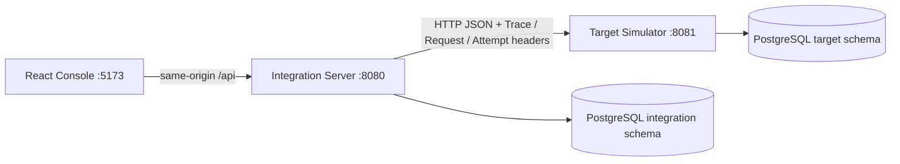
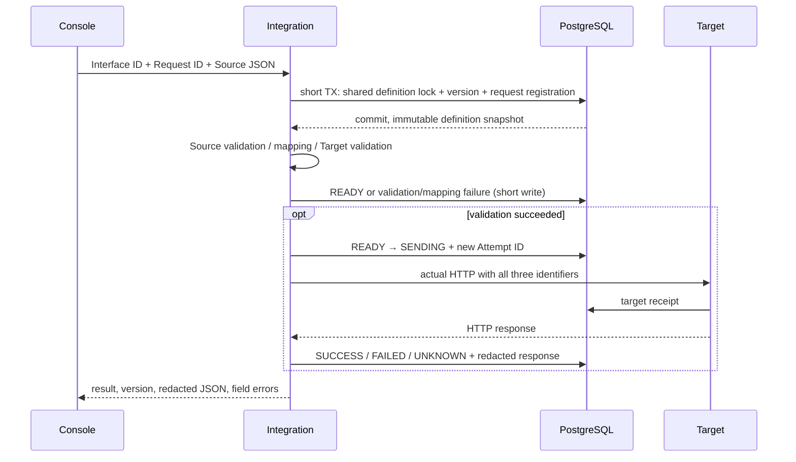
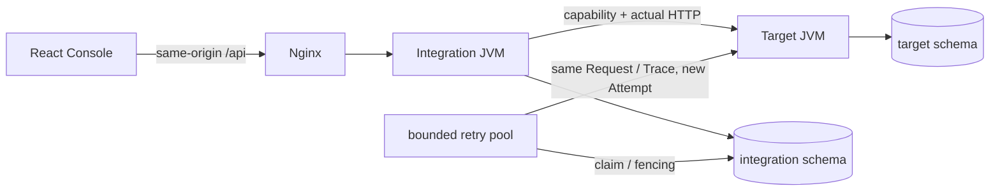

# 아키텍처와 데이터 설계

현재 구현은 Phase 7 로컬 통합 검증 범위다. 아래 Phase별 절은 해당 시점의 설계 이력이며 최신 모델·API·보장 범위는 이 문서의 현행 모델, API.md, PROGRESS.md를 따른다.



common은 DTO만 제공한다. 두 서버는 별도 JVM으로 실행되고 서비스 구현은 공유하지 않는다.
Phase 1은 고정 IF-USER-001 라우팅과 정상 HTTP 왕복만 제공한다. 브라우저가 대상 URL을 지정할 수 없으며 TARGET_URL은 운영자가 설정하는 환경 변수다.

## Phase 1 영속 모델

- integration.if_request: UUID PK, request_id, interface_id, trace_id, attempt_id unique, status, http_status, error_code, created/updated_at.
- target.if_target_receipt: identity PK, request_id, trace_id, attempt_id, created_at.
- 양쪽 trace_id 인덱스, 요청 생성 시간 인덱스. Flyway 이력과 스키마를 서비스별로 분리한다.
- 개인정보 최소화를 위해 Phase 1은 원본 전문을 저장하지 않는다. HTTP 응답 본문은 호출 결과로만 제공한다.

## 초기 최종 모델 계획 (역사적 설계안)

IF_SYSTEM(system_id PK, base_url allow-list), IF_INTERFACE(interface_id PK, source/target FK, enabled, current_version), IF_INTERFACE_VERSION(interface_id/version 복합 PK, snapshot JSONB), IF_FIELD_MAPPING(version FK, source/target path, transform, default/null policy), IF_VALIDATION_RULE(version FK, stage, field, rule).

IF_REQUEST(id UUID PK, interface/source/request_id UNIQUE, payload_hash, trace_id, version FK, status, original/mapped/response JSONB, timestamps), IF_REQUEST_ATTEMPT(attempt_id PK, request FK, sequence UNIQUE per request, HTTP/error/duration), IF_TRACE_EVENT(event_id PK, request/attempt FK, stage, redacted metadata, timestamp), IF_SIMULATION_SCENARIO(id PK, request scope, expiration, failure budget), IF_TARGET_RECEIPT(interface/source/request_id UNIQUE, payload_hash, stored result), IF_RETRY_SCHEDULE(id PK, request FK, due_at, lease_owner/until, retry count).

위 이름은 초기 설계안이다. 현행은 IF_DELIVERY와 IF_BUSINESS_RESULT로 논리 고유키/재처리/업무 멱등성을 분리한다. 실제 스키마는 migration과 아래 현행 모델을 따른다.

## 식별자 및 상태 모델

Request ID는 논리 요청, Trace ID는 전체 처리 흐름, Attempt ID는 HTTP 시도다. Phase 1에서는 호출마다 새 Attempt ID와 내부 UUID를 발급하며 동일 Request ID의 중복 전송을 차단하지 않는다. 유효한 32자리 소문자 hex X-Trace-Id는 수신·전파하고, 그 외에는 새 Trace ID를 발급한다.

Phase 1: SENDING → SUCCESS / FAILED / UNKNOWN. HTTP 4xx는 FAILED, I/O·5xx·응답 계약 불일치는 UNKNOWN. DB 장애는 API 500이며 HTTP 호출 전 기록 실패 시 대상 호출을 하지 않는다. 기록 후 프로세스가 중단되면 SENDING이 남을 수 있으며 자동 복구는 Phase 5 대상이다.

초기 상태 설계안(현행은 요청 status와 delivery state 분리): RECEIVED → VALIDATING → VALIDATION_FAILED 또는 MAPPING_FAILED 또는 READY → SENDING → SUCCESS / FAILED / UNKNOWN / RETRY_WAIT. RETRY_WAIT → READY, 재시도 한도 초과 → DEAD_LETTER. 성공 상태 재전송은 저장 결과를 반환한다. 조건부 UPDATE와 lease로 중복 작업을 방지한다. 수동 재처리는 동일 Request/Trace ID, 새 Attempt ID를 사용한다.

## 경계와 보안

MyBatis 단일 statement를 짧게 커밋하며 외부 HTTP 동안 트랜잭션을 유지하지 않는다. 결과 저장 실패 시 성공으로 응답하지 않는다. Phase 1에서 영속화한 요청·수신 기록으로 trace_id를 SQL 조회할 수 있고 통합 Trace Explorer는 Phase 3에서 구현한다.

로컬 Compose 포트는 loopback에만 바인딩한다. 인증은 미구현이므로 공개 서비스 배포 대상이 아니다. Nginx 전문 제한 64KB, 서버 입력 제한, SQL #{} 바인딩, 전문·비밀값 로그 제외, MDC finally 정리를 적용한다. 향후 민감 필드 재귀 마스킹 및 저장 보관기간 정책을 도입한다.

## Phase 2 현재 구현

- IF_SYSTEM: SOURCE/TARGET 등록 정보. API로 SOURCE만 등록하며 SYSTEM_B가 사전 정의된 대상이다. 실제 URL은 서버 환경 변수로만 설정한다.
- IF_INTERFACE: 현재 메타데이터와 current_version. IF_INTERFACE_VERSION은 불변 snapshot JSONB와 생성 시각, 복합 PK(interface_id,version)를 가진다.
- IF_FIELD_MAPPING / IF_VALIDATION_RULE: 버전 FK와 순번을 가진 규칙 JSONB. 전체 snapshot과 같은 트랜잭션으로 저장한다. 엔진은 전체 snapshot을 읽는다.
- IF_REQUEST 확장: source_system, interface_version FK, original/mapped/response JSONB, validation_errors, processing_stage, duration_ms. Phase 1 행은 기존 값과 null snapshot을 유지한다.
- 목록 인덱스: interface_id/created_at, status/created_at. 요청/응답 전문과 조회 결과는 마스킹된 snapshot이며 보호된 재처리 원본 저장소는 아직 없다.



현재 상태 전환은 VALIDATING → VALIDATION_FAILED / MAPPING_FAILED / READY → SENDING → SUCCESS / FAILED / UNKNOWN이다. 각 UPDATE는 기대 상태를 확인한다. Phase 3는 IF_TRACE_EVENT와 IF_ATTEMPT로 단계 및 HTTP 시도를 저장한다. 재시도/복구 확장은 Phase 5다. 검증 실패에는 Attempt ID를 만들지 않는다. 설정 수정/삭제는 배타 잠금과 version 비교를 사용하며 접수와 경쟁하지 않는다. HTTP 대기 중에는 정의 잠금이 없다.

요청 목록/상세는 RequestLifecycle이 관리하고 XML Mapper만으로 SQL을 실행한다. 목록/총 건수는 REPEATABLE_READ로 일관되게 읽고, 외부 HTTP는 이 트랜잭션에도 포함하지 않는다. 페이지 최대 100, 검색 최대 160자, 모든 SQL 값은 #{} 바인딩이다.

미리보기는 DB 현재 설정 버전으로 엔진을 실행하지만 요청/HTTP/Attempt/이력은 만들지 않는다. Source/Target 검증 규칙은 각각 독립적이며 잘못된 출력이 Target으로 전달되지 않도록 한다.

## 전문 보관 정책

입력과 매핑 출력은 64KiB 이하이며 요청 전문을 로그에 출력하지 않는다. 표준 민감 키와 매핑된 민감 source의 target 경로를 재귀 마스킹한다. 저장된 진단 전문은 실제 HTTP 원문과 다를 수 있다. UI/조회/미리보기도 같은 마스킹을 적용한다. 원본 의미를 완전히 복구할 수 없으므로 이를 재처리 입력으로 사용하지 않는다.

기본 운영 권장 보관 기간은 30일이다. 자동 삭제는 아직 없으며 필요 시 운영자가 보관 정책에 따라 다음 SQL을 별도 적용한다. 진행 중인 요청은 삭제하지 않는다. 설정 버전은 전송 이력 해석을 위해 유지한다.

```sql
DELETE FROM integration.if_request
WHERE created_at < now() - interval '30 days'
  AND status IN ('SUCCESS','FAILED','UNKNOWN','VALIDATION_FAILED','MAPPING_FAILED');
```

인증, 임의 민감 문자열 탐지, 보호된 원문 저장, 타임라인/통계/재시도/멱등성은 이번 Phase에 포함하지 않는다. Docker/원격 CI 검증의 미완료 상태는 PROGRESS에 별도로 남긴다.

## Phase 3 추적 저장

V3는 요청 소유의 IF_TRACE_EVENT와 IF_ATTEMPT를 추가한다. FK는 요청 삭제 시 함께 정리되며 Attempt 이벤트 참조도 보존한다. 요청 상태 변경과 이벤트/Attempt 기록은 같은 짧은 DB 트랜잭션에서 커밋되고 HTTP는 밖에서 실행한다. Trace endpoint는 단일 SQL snapshot으로 요청·이벤트·시도를 조회한다. 과거 데이터는 역산하지 않는다. 통계의 시간·분류·한계는 ADR-010/API 계약을 따른다. 기록에는 진단 마스킹 snapshot만 사용하며 이벤트에 원문이나 임의 메시지를 추가하지 않는다.

## Phase 4 시나리오 소유권과 통신

Target V2는 IF_SIMULATION과 수신 기록의 simulation_id/sequence/planned_http_status를 추가한다. 설정은 불변이고 제어 API는 최근 100개만 조회한다. Target은 atomic UPDATE RETURNING으로 scope·만료·수신 한도를 확인하고 counter와 receipt를 같은 트랜잭션에서 저장한다. 고정된 유형·지연·실패 예산으로 응답을 만들며 DB 커밋 뒤에 sleep한다. planned_http_status는 예정 결과이고 HTTP 전달 보장이 아니다.

Integration V4는 request.simulation_id를 보관한다. 양쪽 서비스는 HTTP로 시나리오를 공유하며 Target schema를 Integration에서 직접 읽지 않는다. 등록/목록/실행 준비용 RestClient는 연결·응답 제한 3초이고, 전문 전송은 기존 인터페이스 timeout을 유지한다. execute 시 접수 트랜잭션 안에서 실제 설정 버전과 TIMEOUT 지연을 검사한다. 일반 send 경로에는 시나리오 헤더를 추가하지 않는다.

CONNECTION_FAILURE 전송은 운영자가 지정한 닫힌 주소로만 라우팅하고 Target 제어 경로는 정상이어야 한다. 수신 횟수 제한은 Target 도달에 적용되므로 이 경로에는 counter/receipt가 없다. 인증·큐·동시 실행의 전체 용량 제어·retry/멱등성은 구현하지 않았다. 상태 정책과 상세 한계는 ADR-011을 따른다.

## Phase 5 영속 실행

Source IF_DELIVERY는 역사 IF_REQUEST에 대한 별도 논리 고유키 등록, canonical hash, AES-GCM replay envelope, 실행 상태/due time/lease token/시도 한도를 가진다. 기존 이력은 합성 등록하지 않는다. 입력 검증/정의 고정/보호 원본 등록은 같은 짧은 트랜잭션이다. worker는 lease와 새 Attempt를 커밋한 후 HTTP를 수행하고 소유 token·미만료를 확인해 결과를 커밋한다. 자동 재시도는 DB 시각으로 다시 검색하므로 서버 재시작으로 대기 스케줄을 잃지 않는다.

Target IF_BUSINESS_RESULT는 출처/인터페이스/Request/namespace 고유키와 변환 전문 hash, OK 업무 결과를 가진다. 키별 advisory lock은 Target의 짧은 DB 처리만 직렬화하며 응답 지연 동안 해제된다. Target 업무 결과·수신 기록이 커밋된 뒤 응답이 손실돼도 후속 전송은 replay receipt만 추가한다. scope 없는 수동 장애 실험은 이 업무 테이블을 사용하지 않는다.

DB 키·마스킹 진단·암호화 원본·Target 결과의 보관 범위는 다르다. 자동 삭제/키 회전은 미구현이며 기존 30일 수동 요청 삭제 SQL은 재처리/Source 고유키도 삭제한다. 적용 전에 양쪽 idempotency horizon과 키 백업 정책을 확인한다. 실행 상태와 마지막 결과 분리, 60초 lease, fencing, 재시도/수동 제한 및 실제 JVM 복구 검증 절차는 ADR-012/013과 scripts/Test-Recovery.mjs에 있다.

## Phase 6 조회와 작업자

History는 keyset metadata만 요청하며 선택 시 마스킹 상세를 별도로 읽는다. 시간/상태 복합 인덱스, 만료 lease 부분 인덱스와 WAIT/LEASED 분리 조회를 적용한다. HTTP 작업은 RETRY_CONCURRENCY(기본 2, 1~4) 고정 풀에서 실행하고 DB claim은 작업 실행 직전에 수행한다. 한 poll 최대 20건이며 전체 배치가 끝난 뒤 다음 poll을 수행한다. 다중 서버의 실제 소유권은 기존 DB lease/fencing이 결정한다. 최초 API 호출은 이 풀의 제한 대상이 아니다. 세 식별자와 불변 버전/보호 원본/UNKNOWN 정책을 유지한다. 측정 근거는 PERFORMANCE.md, 결정은 ADR-014를 따른다.

## 현행 모델 · Phase 7



| 소유자 | 테이블 | 역할 |
| --- | --- | --- |
| Integration | IF_SYSTEM / IF_INTERFACE / IF_INTERFACE_VERSION | 출처/대상 등록, 현재 정의, 불변 실행 snapshot |
| Integration | IF_FIELD_MAPPING / IF_VALIDATION_RULE | 버전별 매핑·검증 projection |
| Integration | IF_REQUEST | 내부 UUID, 논리 Request/Trace, 최신 결과·단계, 마스킹 진단 |
| Integration | IF_ATTEMPT / IF_TRACE_EVENT | 각 실제 시도의 고유 ID/순번/결과와 단계별 저장 이벤트 |
| Integration | IF_DELIVERY | UNIQUE(interface,source,request,scope), hash, 암호화 원본, 실행 상태/예산/lease/token |
| Target | IF_SIMULATION | UUID별 요청 범위/유효기간/실패·수신 한도 |
| Target | IF_BUSINESS_RESULT | 복합 업무 고유키/hash/저장 OK 결과 |
| Target | IF_TARGET_RECEIPT | 각 수신·응답 계획/replay 여부·세 식별자 |

요청 status는 VALIDATING/VALIDATION_FAILED/MAPPING_FAILED/READY/SENDING/SUCCESS/FAILED/UNKNOWN이다. 영속 실행 state는 WAIT/LEASED/DONE/DEAD_LETTER이며 서로 다른 의미다. DEAD_LETTER에 마지막 UNKNOWN이 남을 수 있다. Trace ID는 상관관계, Request ID는 출처·인터페이스·scope 안의 논리 요청, Attempt ID는 개별 HTTP 시도다. 최초 원자적 등록에 첫 lease/Attempt도 포함하며 이후 시도는 고정 버전·원본을 사용한다.

```mermaid
sequenceDiagram
  participant C as Caller
  participant A as Integration
  participant I as Integration DB
  participant B as Target
  participant T as Target DB
  C->>A: same logical key + payload
  A->>I: short TX register/hash/version/envelope/lease/Attempt
  A->>B: capability + business POST (outside DB TX)
  B->>T: short TX unique/hash + result + receipt
  T-->>B: commit
  B--xA: response lost / sender crashes
  Note over A,I: restart; wait actual lease expiry
  A->>I: short TX old Attempt UNKNOWN + new lease/Attempt
  A->>B: same Request/Trace, new Attempt
  B->>T: saved result + replay receipt
  B-->>A: stored OK result
  A->>I: short TX token/expiry check + SUCCESS/DONE
```

일반 HTTP exactly-once 전송은 보장하지 않는다. 업무 중복 방지는 가상 Target 프로토콜·DB 고유키와 키/기록 보관 범위 안에서만 제공한다. 인증·키 회전·자동 삭제·전체 부하 검증은 미구현이다. 실제 전체 스택 검증은 Test-Compose.mjs, 실행·장애 대본은 DEMO.md, 상태와 근거는 PROGRESS.md를 따른다.
