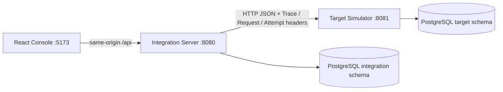

# 아키텍처와 데이터 설계

common은 DTO만 제공한다. 두 서버는 별도 JVM으로 실행되고 서비스 구현은 공유하지 않는다.
Phase 1은 고정 IF-USER-001 라우팅과 정상 HTTP 왕복만 제공한다. 브라우저가 대상 URL을 지정할 수 없으며 TARGET_URL은 운영자가 설정하는 환경 변수다.

## Phase 1 영속 모델

- integration.if_request: UUID PK, request_id, interface_id, trace_id, attempt_id unique, status, http_status, error_code, created/updated_at.
- target.if_target_receipt: identity PK, request_id, trace_id, attempt_id, created_at.
- 양쪽 trace_id 인덱스, 요청 생성 시간 인덱스. Flyway 이력과 스키마를 서비스별로 분리한다.
- 개인정보 최소화를 위해 Phase 1은 원본 전문을 저장하지 않는다. HTTP 응답 본문은 호출 결과로만 제공한다.

## 최종 모델 계획 (아직 미구현)

IF_SYSTEM(system_id PK, base_url allow-list), IF_INTERFACE(interface_id PK, source/target FK, enabled, current_version), IF_INTERFACE_VERSION(interface_id/version 복합 PK, snapshot JSONB), IF_FIELD_MAPPING(version FK, source/target path, transform, default/null policy), IF_VALIDATION_RULE(version FK, stage, field, rule).

IF_REQUEST(id UUID PK, interface/source/request_id UNIQUE, payload_hash, trace_id, version FK, status, original/mapped/response JSONB, timestamps), IF_REQUEST_ATTEMPT(attempt_id PK, request FK, sequence UNIQUE per request, HTTP/error/duration), IF_TRACE_EVENT(event_id PK, request/attempt FK, stage, redacted metadata, timestamp), IF_SIMULATION_SCENARIO(id PK, request scope, expiration, failure budget), IF_TARGET_RECEIPT(interface/source/request_id UNIQUE, payload_hash, stored result), IF_RETRY_SCHEDULE(id PK, request FK, due_at, lease_owner/until, retry count).

위 고유키·FK·JSONB는 해당 Phase의 migration으로 도입한다. 현재 스키마가 최종 멱등성까지 제공한다고 해석하면 안 된다.

## 식별자 및 상태 모델

Request ID는 논리 요청, Trace ID는 전체 처리 흐름, Attempt ID는 HTTP 시도다. Phase 1에서는 호출마다 새 Attempt ID와 내부 UUID를 발급하며 동일 Request ID의 중복 전송을 차단하지 않는다. 유효한 32자리 소문자 hex X-Trace-Id는 수신·전파하고, 그 외에는 새 Trace ID를 발급한다.

Phase 1: SENDING → SUCCESS / FAILED / UNKNOWN. HTTP 4xx는 FAILED, I/O·5xx·응답 계약 불일치는 UNKNOWN. DB 장애는 API 500이며 HTTP 호출 전 기록 실패 시 대상 호출을 하지 않는다. 기록 후 프로세스가 중단되면 SENDING이 남을 수 있으며 자동 복구는 Phase 5 대상이다.

최종 전환: RECEIVED → VALIDATING → VALIDATION_FAILED 또는 MAPPING_FAILED 또는 READY → SENDING → SUCCESS / FAILED / UNKNOWN / RETRY_WAIT. RETRY_WAIT → READY, 재시도 한도 초과 → DEAD_LETTER. 성공 상태 재전송은 저장 결과를 반환한다. 조건부 UPDATE와 lease로 중복 작업을 방지한다. 수동 재처리는 동일 Request/Trace ID, 새 Attempt ID를 사용한다.

## 경계와 보안

MyBatis 단일 statement를 짧게 커밋하며 외부 HTTP 동안 트랜잭션을 유지하지 않는다. 결과 저장 실패 시 성공으로 응답하지 않는다. Phase 1에서 영속화한 요청·수신 기록으로 trace_id를 SQL 조회할 수 있고 통합 Trace Explorer는 Phase 3에서 구현한다.

로컬 Compose 포트는 loopback에만 바인딩한다. 인증은 미구현이므로 공개 서비스 배포 대상이 아니다. Nginx 전문 제한 64KB, 서버 입력 제한, SQL #{} 바인딩, 전문·비밀값 로그 제외, MDC finally 정리를 적용한다. 향후 민감 필드 재귀 마스킹 및 저장 보관기간 정책을 도입한다.
